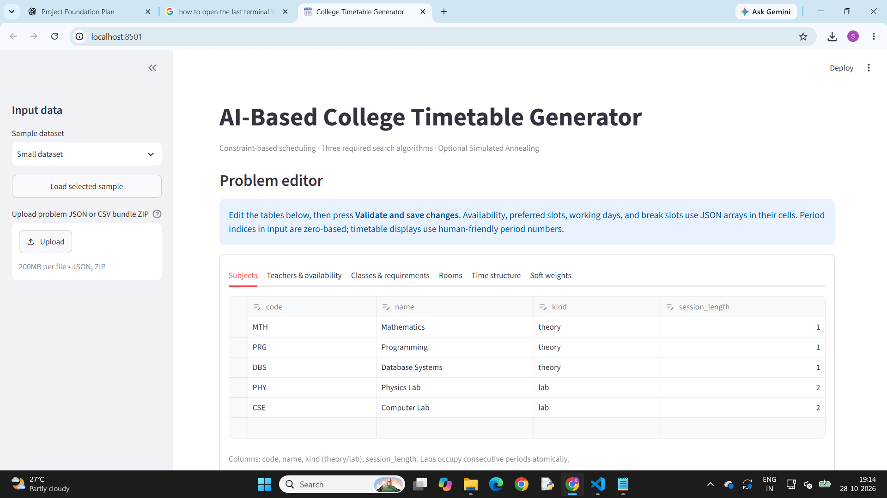
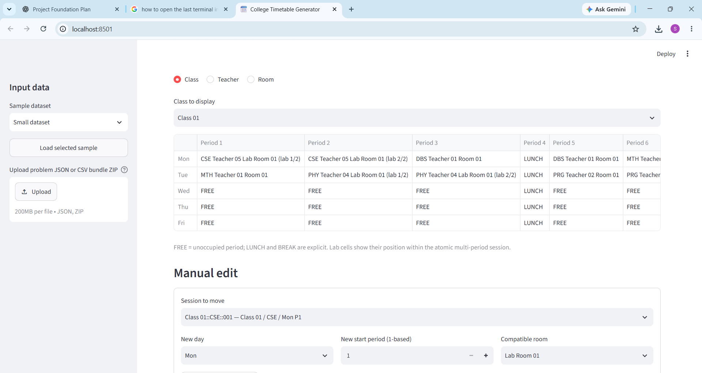
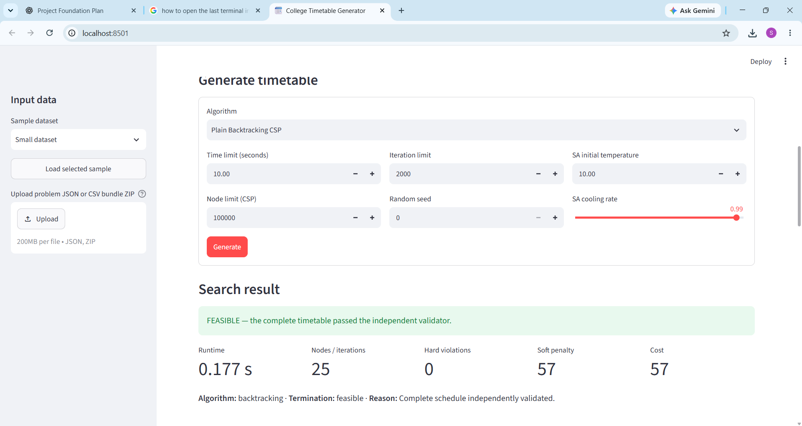

# AI-Based Automated College Timetable Generator Using Search Algorithms

AI-Based Automated College Timetable Generator Using Search Algorithms
A Python and Streamlit application that generates and evaluates college timetables using constraint-satisfaction search and local-search algorithms. It models subjects, teachers, classes, rooms, availability, lunch and break periods, and multi-period lab sessions, then checks candidate schedules with an independent validator.

The project is intended as an academic capstone and a demonstrator of AI search algorithms for timetable scheduling. The bundled small and large datasets are synthetic examples; the application also accepts user-supplied problem data.
Application screenshots
The screenshot below is a genuine capture of the running Streamlit app's problem editor. It shows the sample selector and teacher availability editor; it is not a generated mock-up.

## Application Screenshots

### Main Interface

### Generated Timetable

### Validation and Algorithm Metrics

Problem editor — teacher qualifications, unavailable slots, preferred slots, and weekly teaching-load limits.

Features
- Load the bundled small or large JSON sample dataset.
- Upload a problem as JSON or as a ZIP bundle of CSV tables (subjects.csv, teachers.csv, classes.csv, rooms.csv, and time.csv).
- Edit subjects, teacher qualifications and availability, class requirements, rooms, time structure, and soft-constraint weights in the problem editor.
- Generate timetables using five implemented algorithms: Plain Backtracking CSP, Improved Backtracking CSP, Min-Conflicts, Simulated Annealing, and Hybrid CSP + Simulated Annealing.
- Independently validate complete schedules and report hard violations, soft penalty, total cost, runtime, search effort, and termination status.
- View generated timetables by class, teacher, or room. Free periods, lunch, breaks, and positions within multi-period labs are displayed.
- Manually move one session, validate the result immediately, inspect newly introduced conflicts, and undo the last edit. A lab is moved as one consecutive block; unrelated sessions are not automatically changed.
- Export the current timetable to CSV or Excel. Exports include schedule details and validation information; the Excel workbook also includes a validation summary.
- Reproduce the Phase 4 benchmark protocol and review its saved raw results, summary tables, cost-history data, graph, and report.
A search attempt that stops at a resource limit is not treated as proof that the input is infeasible. A schedule is considered successful only when it is complete and passes the independent final validator.
Algorithms
Algorithm	Design
Plain Backtracking CSP	Recursive baseline with fixed ordering; it does not use MRV, Degree Heuristic, or Forward Checking.
Improved Backtracking CSP	Uses Minimum Remaining Values (MRV), Degree Heuristic tie-breaking, and reversible Forward Checking.
Min-Conflicts	Local search over complete assignments, with seeded tie-breaking, random-walk escape, and configurable restart/iteration limits.
Simulated Annealing (SA)	Improves an already feasible schedule by relocating a session, using geometric cooling and the Metropolis acceptance rule. It rejects neighbors that fail hard-constraint validation, and therefore requires a feasible starting schedule.
Hybrid CSP + SA	Uses Improved Backtracking to construct a feasible schedule, then applies SA refinement only if the CSP stage returns a validated feasible result.

The algorithms share the project's ProblemData model and use the common constraint/scoring definitions. Final success is checked with core/validator.py, independently of the incremental CSP constraint engine.
Constraint handling and cost function
Nine hard-constraint groups
1. H1 — Teacher collision: a teacher cannot teach overlapping sessions.
2. H2 — Class collision: a class cannot attend overlapping sessions.
3. H3 — Room collision: a room cannot host overlapping sessions.
4. H4 — Teacher qualification: the assigned teacher must be qualified for the subject.
5. H5 — Room type: theory sessions require classrooms and lab sessions require labs.
6. H6 — Room capacity: room capacity must meet class strength.
7. H7 — Weekly requirements: each class must receive exactly its required teaching periods for every subject.
8. H8 — Institutional breaks: no session may overlap a defined break slot.
9. H9 — Availability and lunch: sessions may not overlap a teacher's unavailable slots or the class's lunch period.
The validator also checks placement references, valid day/period bounds, subject-defined session duration, and teacher weekly-load limits. Labs are represented as atomic placements occupying consecutive periods.
Soft penalties and objective
The current data uses these weights: S1 = 2, S2 = 3, S3 = 10, S4 = 1, S5 = 1.
- S1 — Class gaps: penalizes empty periods between a class's first and last occupied periods, excluding lunch and institutional breaks.
- S2 — Theory distribution: penalizes repeated theory sessions for the same class and subject on the same day, encouraging distribution across days.
- S3 — Lab duration diagnostic: penalizes malformed lab duration. A valid lab is atomic and has its subject-defined duration, so valid labs receive zero S3 penalty; this is a defensive diagnostic rather than a separate preference for consecutive lab periods.
- S4 — Teacher preferences: penalizes occupied periods outside a teacher's preferred slots when preferences are specified.
- S5 — Late start: penalizes a session starting in the final period of a day.
The implemented objective is:
total_cost = 1000 × hard_violation_count + weighted_soft_penalty_score
The 1000 multiplier makes hard violations dominate ordinary soft penalties. Any candidate with hard violations is invalid even if its total cost is relatively low. A successful timetable must be complete and have zero violations under independent validation.
Technology stack
- Language: Python (the recorded verification environment used Python 3.13.5).
- UI: Streamlit.
- Data handling and tables: pandas.
- Excel export: openpyxl.
- Experiment graph generation: matplotlib.
- PDF report generation: ReportLab.
- Input/output formats: JSON, CSV, ZIP of CSV tables, XLSX, PNG, Markdown, and PDF.
- Automated tests: Python unittest.

Prerequisites and installation
Use Python 3.13 to match the recorded test environment where possible. The dependencies are listed in requirements.txt; no global installation is required. Run all commands from the project root—the directory containing app.py and requirements.txt.
Windows PowerShell
# Confirm you are in the project root
Get-Location
Test-Path .\app.py
Test-Path .\requirements.txt

# Create and activate a virtual environment
py -3.13 -m venv .venv
.\.venv\Scripts\Activate.ps1

# Install the project's existing dependencies
python -m pip install -r requirements.txt

# Run the existing automated tests
python -m unittest discover -s tests -v

# Start the Streamlit app
streamlit run app.py
If py -3.13 is unavailable, install Python 3.13 from the official Python website, or use the python command for an installed compatible version. If PowerShell blocks environment activation, run the environment's executable directly instead:
.\.venv\Scripts\python.exe -m pip install -r requirements.txt
.\.venv\Scripts\python.exe -m unittest discover -s tests -v
.\.venv\Scripts\streamlit.exe run app.py
Streamlit will print a local URL (usually http://localhost:8501) to open in your browser.
How to use the application
1. Start the app with streamlit run app.py.
2. In the left sidebar, choose Small dataset or Large dataset, then click Load selected sample. Alternatively, upload a JSON problem or a ZIP containing all five CSV tables.
3. Review or edit the Subjects, Teachers & availability, Classes & requirements, Rooms, Time structure, and Soft weights tabs. Press Validate and save changes after editing. Availability and other list/object fields in the tables use JSON-formatted cell values.
4. In Generate timetable, select one of the five algorithms. Configure the time/node or iteration limits and random seed as applicable, then click Generate.
5. Review the status, termination reason, runtime, nodes/iterations, hard violations, soft penalty, and total cost. A feasible result is accepted only after independent validation.
6. Use Timetable views to switch among class, teacher, and room views. Use Manual edit to move one session, and Undo last edit to restore the previous schedule.
7. Under Export, download the current timetable as CSV or Excel. If an edit introduces conflicts, the current schedule and export remain labelled with validation information rather than silently repairing other sessions.
CSV upload format: upload a ZIP bundle containing subjects.csv, teachers.csv, classes.csv, rooms.csv, and time.csv. Nested/list-valued cells such as teacher qualifications, availability slots, class requirements, working days, and break slots are represented as JSON strings. See ui/services.py for the exact conversion contract.
Datasets and experimental evaluation
The bundled examples are synthetic and include verification_witness schedules that are independently validated.
Characteristic	Small	Large
Subjects	5	5
Teachers	6	15
Classes	3	8
Rooms	4	8
Working days	5	5
Periods per day	6	7
Required teaching periods	30	80

Phase 4 evaluated all five algorithms on both datasets with 64 attempts: one run per dataset for each deterministic Backtracking method and ten seeded runs per dataset for each of Min-Conflicts, SA, and Hybrid. The saved artifacts and exact parameter settings are in reports/phase4/; no benchmark needs to be rerun to read the report.

The recorded experiment had 42 successful complete schedules out of 64 attempts. The result is configuration-specific: large-dataset resource limits prevented some methods from finding a feasible schedule, and such cutoffs are not proofs of infeasibility. Standalone SA begins from an independently validated witness, so its recorded runtime measures refinement and excludes witness preparation; Hybrid runtime includes CSP construction. Read the report's experimental setup and limitations before comparing runtimes.

To resume the saved benchmark protocol intentionally (not required just to run the app), use the project environment and run:
python -m experiments.run_benchmarks
The benchmark runner resumes from saved results. The separate python -m experiments.generate_report command regenerates the report and graph, so do not run it unless you explicitly intend to replace those artifacts. Review experiments/README.md and PROJECT_STATUS.md before resetting any experiment artifacts. Do not rerun experiments merely to read the saved results. The report-generation command can overwrite the existing PDF and Markdown report; do not run it for this documentation-only phase.
Limitations and future improvements
- The supplied datasets are synthetic, and conclusions should not be generalized to every institution without testing real data.
- Results depend on search limits, algorithm parameters, and the dataset; some large-dataset attempts timed out or reached iteration limits.
- Standalone SA optimizes a feasible initial schedule rather than constructing one from scratch, so its runtime is not directly equivalent to end-to-end CSP runtime.
- Future work could evaluate larger real institutional datasets, additional random seeds and parameter sensitivity, richer user preferences, and more scalable conflict evaluation.
- A Windows-local application smoke test should be performed in the target environment before final submission; the recorded verification environment was Linux.
Team members and proposed contributions
The following is the team's proposed allocation and should be confirmed by all members before submission. It describes responsibility areas, not independently verified individual authorship.
- Shruti Chauhan: problem formulation, cost function, and results interpretation.
- Divyansha Yadav: CSP algorithms and constraint validation.
- Himani Goel: local-search algorithms and hybrid approach.
- Shivam: Streamlit application, data handling, exports, and experiment integration.